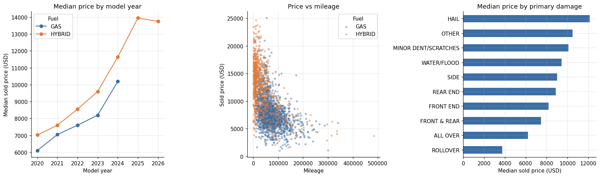
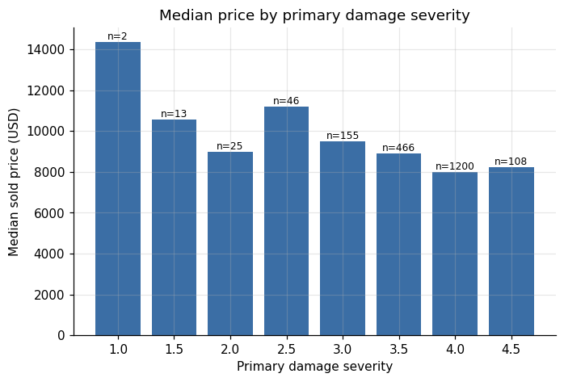
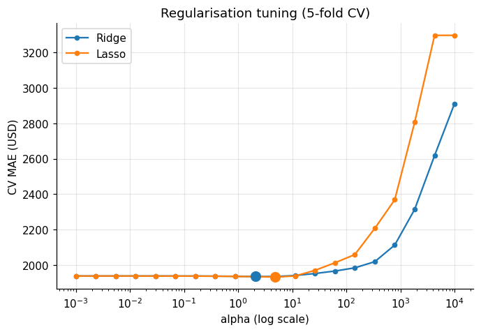
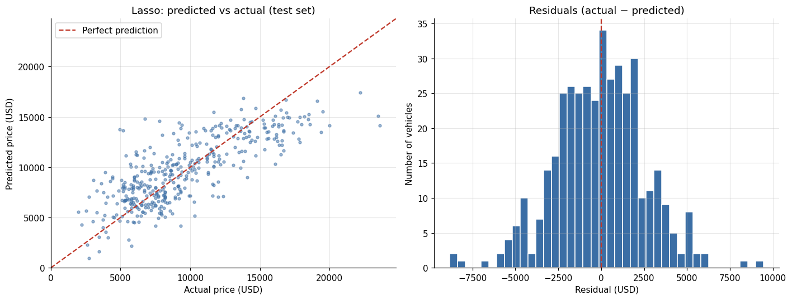
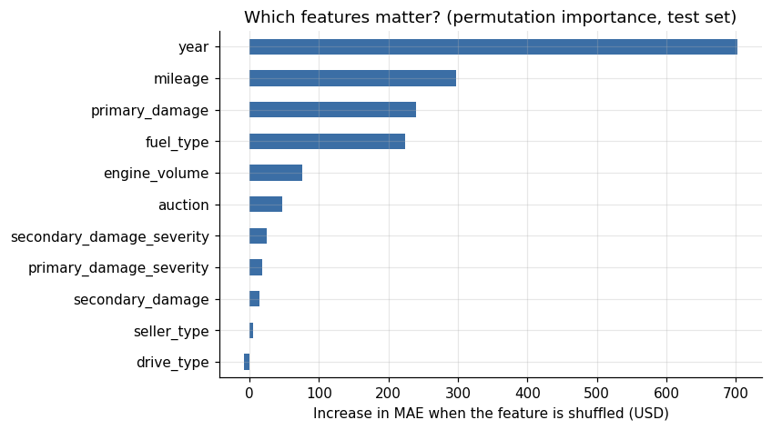
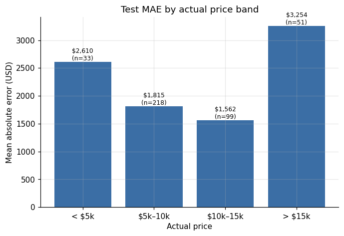

# Toyota Camry Auction Price Prediction

Predicting used Toyota Camry auction sale prices in USD using vehicle specifications, mileage, seller information, and damage data.



## Data and Workflow

- Source: scraped Copart and IAAI auction listings (487,545 listings, all makes). The raw file is not included in this repository because of its size.
- Audited dataset: **2,672 Toyota Camrys, model years 2020–2026**, sold between December 2025 and March 2026.
- Data cleaning:
  - Checked fuel type and drive type against the **VIN powertrain code** (VIN characters 5–7). All 343 cars labelled fuel type `OTHER` turned out to be hybrids, and the `UNKNOWN` fuel and drive values were recovered the same way.
  - Converted 8 CAD prices to USD.
  - Set odometer placeholders (`1`, `999999`) to missing instead of dropping those cars.
  - Removed 9 scrap-value wrecks that sold for under $1,000.
  - Dropped columns with no information (`cylinders` duplicates engine size, and every car is automatic).
  - Excluded a column computed from sale prices (`make_model_year_price_median`) to avoid target leakage.
- Random split: 70% training, 15% validation, 15% testing.
- Preprocessing: median imputation, missing-value indicators, numeric scaling, and one-hot encoding.
- Models: Linear Regression, Ridge, and Lasso, with five-fold cross-validation for regularization tuning.
- Preprocessing stays inside the pipeline to prevent leakage during fitting and cross-validation.

<p float="left">
  
  
</p>

## Results

Lasso (alpha ≈ 4.8) was selected using validation results, then refitted on training and validation data and evaluated once on the test set.

| Metric | Test set |
|---|---|
| MAE | $2,000.79 |
| RMSE | $2,569.52 |
| R² | 0.600 |

Linear Regression, Ridge and Lasso performed almost identically. Regularization barely changes the fit with this number of features.



<p float="left">
  
  
</p>

Key findings:
- Model year is the strongest price driver, followed by mileage, primary damage type and fuel type (hybrids sell for more).
- Hail-damaged cars (mostly cosmetic damage) sell highest, while all-over and rollover damage sell lowest.
- Errors are smallest for $5k–15k cars and largest above $15k, where the model underestimates the most expensive cars.

## Limitations

Results reflect a historical random split, not current-market forecasting. Trim level, title type and real vehicle condition are not in the data and likely explain much of the remaining error. MAE is an average error, not a prediction interval. Further model development should use fresh held-out data for independent evaluation.

## How to run

```bash
uv sync
```

Put `final_dataset.csv` in the project root, open `main.ipynb` with the project's `.venv` kernel, and run all cells. Charts are saved to `images/`.
